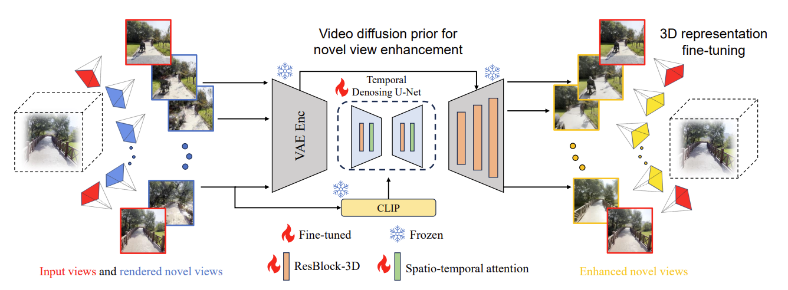

# 3DGS-Enhancer: Enhancing Unbounded 3D Gaussian Splatting with View-consistent 2D Diffusion Priors 
## (NeurIPS 2024 $\textcolor{red}{Spotlight}$)
[**Paper**](https://arxiv.org/abs/2410.16266) | [**Project Page**](https://xiliu8006.github.io/3DGS-Enhancer-project/)

[Xi Liu](https://xiliu8006.github.io/), [Chaoyi Zhou](https://chaoyizh.github.io/chaoyizh-home-page/), [Siyu Huang](https://siyuhuang.github.io/#)

## Abstract
Abstract: Novel-view synthesis aims to generate novel views of a scene from multiple input images or videos, and recent advancements like 3D Gaussian splatting (3DGS) have achieved notable success in producing photorealistic renderings with efficient pipelines. However, generating high-quality novel views under challenging settings, such as sparse input views, remains difficult due to insufficient information in under-sampled areas, often resulting in noticeable artifacts. This paper presents 3DGS-Enhancer, a novel pipeline for enhancing the representation quality of 3DGS representations. We leverage 2D video diffusion priors to address the challenging 3D view consistency problem, reformulating it as achieving temporal consistency within a video generation process. 3DGS-Enhancer restores view-consistent latent features of rendered novel views and integrates them with the input views through a spatial-temporal decoder. The enhanced views are then used to fine-tune the initial 3DGS model, significantly improving its rendering performance. Extensive experiments on large-scale datasets of unbounded scenes.

## Method


<p align="center"> TL;DR: We propose a method that exploits view-consistent 2D generative priors, i.e., a video diffusion model, to enhance 3D Gaussian splatting rendering quality.</p>

## Installation

```bash
git clone --recursive https://github.com/xiliu8006/3DGS-Enhancer.git
cd 3DGS-Enhancer
conda create -n enhancer python=3.9 -y
conda activate enhancer
pip install torch==2.1.0 torchvision==0.16.0 --index-url https://download.pytorch.org/whl/cu121
pip install -r requirements.txt
```

## Checkpoint

Download the full 3DGS-Enhancer checkpoint (SVD + spatial-temporal decoder, about 9 GB) from
[Google Drive](https://drive.google.com/drive/folders/1M-xtjP-Nc_0pKwRc6qhPvYkzDUcz-K_T?usp=sharing) into `checkpoints/3DGS-Enhancer`:

```
checkpoints/3DGS-Enhancer
├── model_index.json
├── unet/  vae/  image_encoder/  feature_extractor/  scheduler/
└── refine_decoder/
```

## Quick start

**1. Render a sparse-view 3DGS.** The [dataset generator](submodules/3dgs_dataset_generator) trains a 3DGS on N input
views of a DL3DV scene (a folder with `images_4/` and `colmap/sparse/0/`) and renders the novel views between them.
It needs its own environment, see its README.

```bash
cd submodules/3dgs_dataset_generator
python train_render.py --scene_path <dl3dv_root>/<scene> --output_path <lq_root>/<scene> --num_samples 3 --use_lr --port 6009
```

**2. Enhance the renderings.**

```bash
python example.py --model_path checkpoints/3DGS-Enhancer --lq_root <lq_root> --gt_root <dl3dv_root> \
    --scene <scene> --num_views 3 --output_path outputs/
```

The enhanced 960x512 frames are written to `outputs/<scene>/`. They can then be used together with the input views to
fine-tune the 3DGS. Inference needs a GPU with about 60 GB of memory (A100 80GB or H100).

Using the pipeline in your own code:

```python
from pipelines.pipeline_3dgs_enhancer import Enhancer3DGSPipeline  # in submodules/SVDFor3D

pipeline = Enhancer3DGSPipeline.from_pretrained("checkpoints/3DGS-Enhancer").to("cuda")
# frames: [26, 3, 512, 960] in [0, 1], clean input views first and last; poses: [26, 19]
enhanced = pipeline(frames, poses).frames
```

## Reference
If you find our work helpful, please consider citing:

```bibtex
@inproceedings{liu20243dgs,
  title = {3DGS-Enhancer: Enhancing Unbounded 3D Gaussian Splatting with View-Consistent 2D Diffusion Priors},
  author = {Liu, Xi and Zhou, Chaoyi and Huang, Siyu},
  booktitle = {Advances in Neural Information Processing Systems (NeurIPS)},
  year = {2024}
}
```
